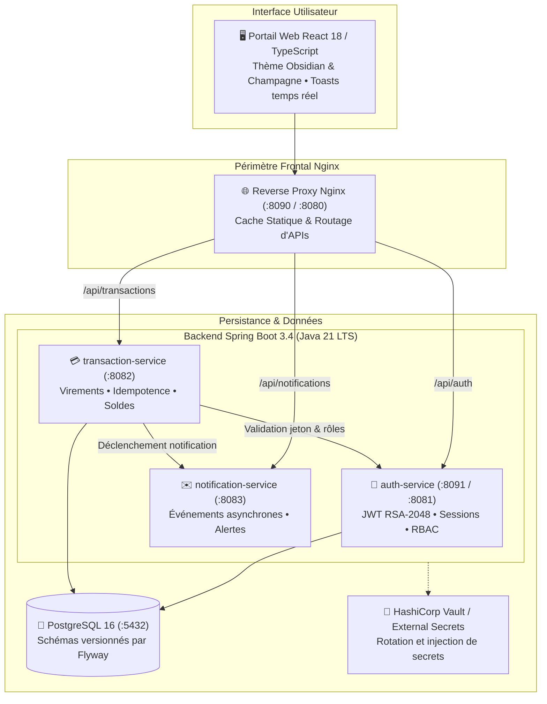

# 🏦 OmniPay Zero-Trust — Dépôt Applicatif & Pipeline DevSecOps (`omnipay-app`)

[](https://github.com/achmaouiayoub120-beep/omnipay-app/releases/tag/v1.0.0)
[](https://github.com/achmaouiayoub120-beep/omnipay-app)
[-orange.svg?style=for-the-badge&logo=jenkins)](https://github.com/achmaouiayoub120-beep/omnipay-app)
[](https://github.com/achmaouiayoub120-beep/omnipay-app)
[](#)

> [!IMPORTANT]
> **Avertissement Académique & Simulation Pédagogique :**  
> Ce projet constitue la réalisation de fin d'études du module **DevOps / DevSecOps** à l'**ESTC (Promo 2026)**.  
> Il s'agit d'une simulation industrielle rigoureuse d'une néobanque en ligne. Aucune donnée financière réelle, aucun secret de production ni aucune clé privée réelle n'y sont stockés ni manipulés.

---

## 📑 Sommaire
1. [Présentation Globale du Projet](#1-présentation-globale-du-projet)
2. [Architecture Système & Microservices](#2-architecture-système--microservices)
3. [Matrice des Rôles de l'Équipe](#3-matrice-des-rôles-de-léquipe)
4. [Bilan d'Avancement des Sprints (S1 à S4)](#4-bilan-davancement-des-sprints-s1-à-s4)
5. [Portail Bancaire & Comptes de Démonstration](#5-portail-bancaire--comptes-de-démonstration)
6. [Organisation du Dépôt `omnipay-app`](#6-organisation-du-dépôt-omnipay-app)
7. [Démarrage Rapide (Docker Compose & Scripts Soutenance)](#7-démarrage-rapide-docker-compose--scripts-soutenance)
8. [Pipeline DevSecOps 11 Stages & Sécurité Shift-Left](#8-pipeline-devsecops-11-stages--sécurité-shift-left)
9. [Validation des Tests & Qualité de Code](#9-validation-des-tests--qualité-de-code)
10. [Gouvernance Git & Liens Utiles](#10-gouvernance-git--liens-utiles)

---

## 1. Présentation Globale du Projet

**OmniPay Zero-Trust** modélise l'ensemble des services numériques critiques et l'infrastructure d'une néobanque moderne. L'objectif fondamental est de démontrer la maîtrise industrielle du cycle de vie logiciel de bout en bout :

$$\text{Planifier} \longrightarrow \text{Coder} \longrightarrow \text{Construire} \longrightarrow \text{Tester} \longrightarrow \text{Déployer} \longrightarrow \text{Surveiller} \longrightarrow \text{Apprendre}$$

### Les Principes Clés Implémentés :
- **Paradigme Zero-Trust** : Aucune entité (interne ou externe) ne bénéficie d'une confiance implicite. Chaque requête API est authentifiée cryptographiquement, autorisée via RBAC et vérifiée en temps réel.
- **Sécurité Shift-Left** : Les contrôles de sécurité (détection de fuites de secrets, analyse statique SAST, scanning de vulnérabilités CVE, audit des Dockerfiles) interviennent dès les premières étapes du pipeline de build.
- **Intégrité de la Chaîne d'Approvisionnement (SLSA)** : Génération de SBOMs (Software Bill of Materials) et signature cryptographique d'images avec **Cosign**.
- **Résilience SRE & Haute Disponibilité** : Mécanismes d'idempotence sur les transactions financières, déploiements progressifs Canary via **Argo Rollouts** et surveillance continue des métriques SLO/SLI avec **Prometheus** et **Grafana**.

---

## 2. Architecture Système & Microservices



### Détail des Composants Applicatifs :
1. **Portail Web Bancaire (`services/frontend`)** :
   - Développé en **React 18 / TypeScript / Vite / Tailwind CSS**.
   - Composants d'ergonomie bancaire : Thème Obsidian & Champagne, Dark/Light mode réactif, Toasts d'alerte immédiats lors des pannes réseau ou des rejets de transaction.
   - Validation qualité : **70 tests unitaires et d'intégration Vitest réussis à 100%**.
2. **Microservice Authentification (`services/auth`)** :
   - Émission et validation de jetons JWT asymétriques signés avec des clés RSA-2048.
   - Gestion des rôles RBAC (`ROLE_USER`, `ROLE_ADMIN`, `ROLE_AUDITOR`).
   - Mots de passe chiffrés via **BCrypt** (coût 10).
3. **Microservice Transactions (`services/transaction`)** :
   - Exécution des transferts de fonds avec contrôle d'intégrité et verrouillage optimiste.
   - Mécanisme d'idempotence strict (table `idempotency_keys`) pour éviter tout double débit accidentel.
   - Journalisation immuable des écritures comptables.
4. **Microservice Notifications (`services/notification`)** :
   - Traitement asynchrone des accusés d'opérations et alertes de sécurité par e-mail simulé.

---

## 3. Matrice des Rôles de l'Équipe

Le projet a été mené par une équipe de 5 étudiants ingénieurs de l'ESTC, chacun assurant la responsabilité d'un pôle d'expertise :

| Rôle | Responsable | Pôle Technique | Missions & Livrables Clés |
| :---: | :--- | :--- | :--- |
| **P1** | **Ayoub Achmaoui** | Lead, CI/CD & Release | • Architecture CI/CD & Jenkins Configuration as Code (`JCasC`)<br>• Shift-Left Security (Gitleaks, Threat Model STRIDE)<br>• Pilotage de la release officielle `v1.0.0` et gouvernance Git |
| **P2** | **Amira Adolf** | Software & Frontend Lead | • Développement des microservices Java 21 / Spring Boot 3.4<br>• Portail Web Bancaire React 18 / TypeScript & Nginx<br>• Couverture de tests unitaires (70/70 Vitest) et gestion des pannes UI |
| **P3** | **Moadh Elkamel** | Platform & Infrastructure | • Provisionnement K3s via Terraform & Ansible<br>• Persistance PostgreSQL & migrations Flyway<br>• Gestion centralisée des secrets HashiCorp Vault & NetworkPolicies |
| **P4** | **Widad El Gharzaz** | GitOps & Supply Chain | • Dépôt GitOps déclaratif [`omnipay-gitops`](https://github.com/achmaouiayoub120-beep/omnipay-gitops)<br>• Registre privé durci Harbor, signature Cosign & admission Kyverno<br>• Déploiement progressif Canary avec Argo Rollouts & auto-rollback |
| **P5** | **Abdelmounaim El Mahdaoui** | Observabilité & SRE | • Monitoring Prometheus, métriques SLO/SLI & Alertmanager<br>• Tableaux de bord Grafana & traçabilité Tempo/Loki<br>• Détection d'intrusion au runtime Falco eBPF & métriques DORA |

---

## 4. Bilan d'Avancement des Sprints (S1 à S4)

```text
S1 : Socle & CI/CD       S2 : DevSecOps & Build   S3 : GitOps & SRE        S4 : UI, Qualité & v1.0.0
───────────────────      ──────────────────────   ─────────────────        ─────────────────────────
• Git & Conventions      • Pipeline 11 Stages     • Multi-Env GitOps       • Portail React 18 UX
• Jenkins JCasC          • Hadolint / SonarQube   • Vault & External Sec   • 70/70 Tests Vitest
• Gitleaks Shift-Left    • Trivy / Syft SBOM      • Canary Argo Rollouts   • Tests de charge k6
• Microservices Spring   • Registre Harbor        • Falco eBPF Runtime     • Clôture & Tag v1.0.0
```

- [x] **Sprint 1 (Fondations)** : Mise en place des dépôts, configuration de Jenkins as Code, détection anti-fuite de clés Gitleaks, conteneurisation initiale des microservices.
- [x] **Sprint 2 (Pipeline DevSecOps)** : Implémentation du pipeline à 11 stages avec contrôles de qualité SonarQube, analyse de vulnérabilités Trivy, signature Cosign et persistance PostgreSQL versionnée par Flyway.
- [x] **Sprint 3 (GitOps & Résilience)** : Orchestration ArgoCD sur K3s avec Kustomize (dev, recette, prod), gestion des secrets sous Vault, politique d'admission Kyverno et Canary Rollouts avec rollback automatique.
- [x] **Sprint 4 (Expérience Utilisateur & Clôture)** : Finalisation du portail web React 18, 70 tests Vitest passés à 100%, tests de charge k6 sous jeton JWT, fusions des PRs (#30, #28) et publication des **Releases officielles `v1.0.0`**.

---

## 5. Portail Bancaire & Comptes de Démonstration

L'application web est accessible en direct à l'adresse **`http://localhost:8090`** (ou `http://localhost:8080`).

Les comptes de démonstration suivants sont pré-configurés et vérifiés en base de données :

| Compte | Identifiant | Mot de passe | Rôles RBAC | Solde Initial | Description |
| :--- | :--- | :--- | :--- | :--- | :--- |
| **Alice Dupont** | `alice` | `alice-demo-pass` | `ROLE_USER` | **1 000,00 €** | Compte bancaire principal, émission de virements, consultation du solde et notifications. |
| **Bob Martin** | `bob` | `bob-demo-pass` | `ROLE_USER` | **500,00 €** | Compte destinataire pour tester les virements inter-comptes. |
| **Administrateur** | `admin` | `password` | `ROLE_ADMIN`, `ROLE_USER` | **50 000,00 €** | Accès aux outils de supervision, statistiques système et console de gestion. |
| **Auditeur** | `auditor` | `password` | `ROLE_AUDITOR` | *Consultation seule* | Consultation intégrale de la piste d'audit sans droit d'écriture. |
| **Utilisateur standard**| `user` | `password` | `ROLE_USER` | **14 250,00 €** | Compte général pour les tests fonctionnels. |

> [!TIP]
> Sur la mire de connexion du Frontend, un clic sur le nom d'un profil pré-remplit instantanément son identifiant et son mot de passe.

---

## 6. Organisation du Dépôt `omnipay-app`

```text
omnipay-app/
├── .github/
│   ├── ISSUE_TEMPLATE/           # Modèles d'issues (features, bugs, sécurité)
│   └── PULL_REQUEST_TEMPLATE.md  # Template strict de revue de code
├── ci/
│   ├── Jenkinsfile               # Pipeline déclaratif principal (11 stages)
│   ├── jenkins-casc.yaml         # Configuration as Code pour Jenkins
│   ├── docker-compose-jenkins.yml# Déploiement local du contrôleur Jenkins
│   └── scripts/                  # Scripts de vérification CI, Hadolint & Trivy
├── docs/
│   ├── architecture/             # Diagrammes C4 et spécifications techniques
│   ├── adr/                      # Architecture Decision Records (ADR-001 à 010)
│   ├── security/                 # Threat Model STRIDE & politique Gitleaks
│   └── runbooks/                 # Procédures opérationnelles de dépannage
├── helm/
│   └── omnipay/                  # Charts Helm pour déploiement sur K3s
├── infra/
│   ├── terraform/                # Infrastructure as Code (K3s, Réseau)
│   └── ansible/                  # Rôles d'automatisation et durcissement OS
├── services/
│   ├── auth/                     # Microservice Spring Boot JWT (port 8081/8091)
│   ├── transaction/              # Microservice Spring Boot Virements (port 8082)
│   ├── notification/             # Microservice Spring Boot Notifications (port 8083)
│   └── frontend/                 # Portail React 18 TypeScript & Nginx (port 8080/8090)
├── scripts/
│   ├── soutenance.ps1            # Orchestrateur soutenance tout-en-un (PowerShell)
│   ├── soutenance.sh             # Orchestrateur soutenance tout-en-un (Bash)
│   └── release-v1.sh/.ps1        # Procédure de validation de release v1.0.0
├── tests/
│   ├── load/                     # Banc de tests de charge k6 avec JWT
│   └── security/                 # Scripts d'audit et tests de pénétration
├── docker-compose.yml            # Stack d'exécution locale durcie
├── .gitleaks.toml                # Configuration du scanner Shift-Left
├── CONTRIBUTING.md               # Règles de contribution & Conventional Commits
└── LICENSE                       # Licence académique ESTC
```

---

## 7. Démarrage Rapide (Docker Compose & Scripts Soutenance)

### Prérequis
- Docker Desktop (ou Docker Engine $\ge 24$) & Docker Compose $\ge 2.20$.
- Git $\ge 2.40$.

### Option 1 : Lancement standard via Docker Compose
```bash
# Lancement de l'ensemble des services en arrière-plan :
docker compose up -d

# Visualisation des conteneurs actifs et de leur santé :
docker compose ps
```

### Option 2 : Orchestrateur Tout-en-un de Soutenance
```powershell
# Sous Windows PowerShell :
.\scripts\soutenance.ps1 -Action install
.\scripts\soutenance.ps1 -OpenBrowser

# Sous Linux / macOS / Bash :
chmod +x ./scripts/soutenance.sh
./scripts/soutenance.sh install
./scripts/soutenance.sh start --open
```

### Matrice des Ports & Endpoints
| Service | Port Externe | URL d'accès direct |
| :--- | :---: | :--- |
| **Portail Web Bancaire (React 18 / Nginx)** | **8090** | `http://localhost:8090` |
| **Auth Microservice** | **8091** | `http://localhost:8091/api/auth/health` |
| **Transaction Microservice** | **8082** | `http://localhost:8082/api/transactions/health` |
| **Notification Microservice** | **8083** | `http://localhost:8083/api/notifications/health` |
| **Contrôleur Jenkins CI/CD** | **8088** | `http://localhost:8088` |
| **Base de Données PostgreSQL** | **5432** | `localhost:5432` (db: `omnipay_db`) |

---

## 8. Pipeline DevSecOps 11 Stages & Sécurité Shift-Left

Le fichier [`ci/Jenkinsfile`](ci/Jenkinsfile) orchestre un pipeline de livraison sécurisé rigoureux :

```text
 1. SCM Checkout ──────────► Clone sécurisé du dépôt et vérification du commit SHA
 2. Secret Detection ──────► Audit Gitleaks anti-fuite de clés (échec bloquant)
 3. Dockerfile Linting ────► Validation Hadolint (respect des standards non-root)
 4. Build & Unit Tests ────► Compilation Maven (JDK 21) & 70 tests Vitest (React 18)
 5. SonarQube SAST ────────► Analyse de qualité et validation de la Quality Gate
 6. Multi-Stage Build ─────► Génération des images OCI durcies et allégées
 7. Trivy Security Scan ───► Détection des vulnérabilités critiques dans les conteneurs
 8. SBOM Generation ───────► Production de l'inventaire des composants via Syft
 9. Harbor Push ───────────► Dépôt des images dans le registre privé sécurisé
10. Cosign Signature ──────► Signature cryptographique des images avec clé privée
11. GitOps Trigger ────────► Notification et mise à jour de la révision dans omnipay-gitops
```

---

## 9. Validation des Tests & Qualité de Code

### Exécution des Tests Frontend (Vitest)
```bash
cd services/frontend
npm install
npm test
```
**Résultat garanti :** 15 suites de tests exécutées, **70/70 tests passés avec succès**, 0 avertissement TypeScript.

### Audit des Secrets en Local
```bash
# Sous Windows PowerShell :
powershell -ExecutionPolicy Bypass -File ci/scripts/audit-secrets.ps1 .

# Sous Linux / Bash :
./ci/scripts/audit-secrets.sh .
```

---

## 10. Gouvernance Git & Liens Utiles

- 📦 **Release GitHub Officielle** : [Release v1.0.0 (omnipay-app)](https://github.com/achmaouiayoub120-beep/omnipay-app/releases/tag/v1.0.0)
- 🚀 **Dépôt GitOps Associé** : [achmaouiayoub120-beep/omnipay-gitops](https://github.com/achmaouiayoub120-beep/omnipay-gitops)
- 📜 **Attestation de Clôture de Projet** : [Consulter l'attestation 100%](file:///C:/Users/ayoub/.gemini/antigravity/brain/b0596680-dfad-4378-92c9-fddfa5ea63bd/attestation-cloture-projet-100-pourcent.md)
- 📋 **Guide de Contribution** : [CONTRIBUTING.md](CONTRIBUTING.md)

---
*OmniPay Zero-Trust — Projet de Fin d'Études ESTC Promo 2026 — Licence Académique*
