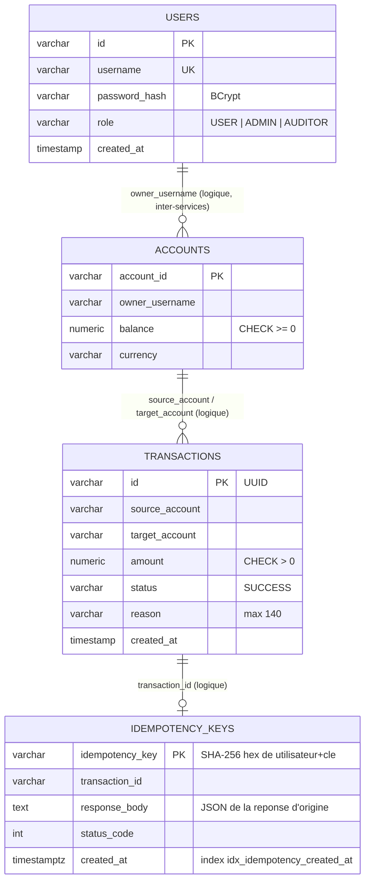

# Spécification technique des microservices OmniPay (P2 — S1 à S4)

> Mini-banque **simulée** à des fins académiques : aucune logique financière réelle,
> comptes et soldes de démonstration uniquement, aucun secret dans le code.

## 1. Architecture

```text
            ┌──────────────┐  /api/auth          ┌────────────────┐      ┌─────────────────────┐      ┌──────────────────────┐
 client ──► │ frontend     │ ──────────────────► │ auth-service   │      │ transaction-service │ ───► │ notification-service │
            │ Nginx :8080  │  /api/transactions  │ :8081          │      │ :8082               │      │ :8083                │
            │              │ ────────────────────┼────────────────┼────► │                     │      └──────────────────────┘
            └──────────────┘                     └────────────────┘      └──────────┬──────────┘
                                               │ (S2+)
                                        ┌──────▼──────┐
                                        │ PostgreSQL  │  postgres:16-alpine, :5432
                                        └─────────────┘
```

| Service | Module Maven | Port | Rôle |
|---|---|---|---|
| frontend | `services/frontend` | 8080 | Portail web bancaire (Nginx non-root) + reverse-proxy des API |
| auth-service | `services/auth` | 8081 | Login (BCrypt), émission et validation de jetons JWT signés (rôles RBAC) |
| transaction-service | `services/transaction` | 8082 | Virement atomique et idempotent, filtre JWT + RBAC (JDBC + Flyway) |
| notification-service | `services/notification` | 8083 | Envoi simulé (journalisation), identifiant `NT-<uuid>` |

Les services sont indépendants (pas d'appel inter-services). Depuis la Semaine 2, `auth` et
`transaction` persistent leurs données via JDBC (`JdbcClient`) ; le schéma est versionné avec
**Flyway** (`src/main/resources/db/migration/`) et appliqué au démarrage.

- Par défaut (sans variable) : base **H2 en mémoire** (mode PostgreSQL) — tests et démarrage local autonomes.
- Avec PostgreSQL : définir `SPRING_DATASOURCE_URL`, `SPRING_DATASOURCE_DRIVER=org.postgresql.Driver`,
  `SPRING_DATASOURCE_USERNAME`, `SPRING_DATASOURCE_PASSWORD`. **Une base (ou un schéma) distincte par service** :
  chaque service a sa propre migration `V1` et sa propre table `flyway_schema_history`.

Stack : Java 21, Spring Boot 3.4.1, Maven multi-modules, JDBC + Flyway, Actuator + Micrometer Prometheus, JaCoCo.

## 2. Matrice des endpoints

| Service | Méthode | Chemin | Succès | Erreurs |
|---|---|---|---|---|
| auth | POST | `/api/auth/login` | 200 | 400 si `username` ou `password` vide/absent ; 401 si identifiants invalides |
| auth | GET | `/api/auth/validate` | 200 (claims décodés) | 401 si jeton absent, invalide, expiré ou d'un autre émetteur |
| auth | GET | `/api/auth/health` | 200 (public) | — |
| transaction | POST | `/api/transactions` (alias `/transfer`) | 200 — rôles USER, ADMIN | 400 données invalides ; 401 sans jeton valide ; 403 rôle insuffisant ou compte d'un autre utilisateur ; 404 compte introuvable ; 422 solde insuffisant |
| transaction | GET | `/api/transactions` | 200 — rôles USER, ADMIN, AUDITOR | 401 / 403 |
| transaction | GET | `/api/transactions/accounts/me` | 200 — rôles USER, ADMIN, AUDITOR | 401 / 403 |
| transaction | GET | `/api/transactions/health` | 200 (public) | — |
| notification | POST | `/api/notifications/send` | 200 | 400 si `recipient` ou `message` vide/absent |
| notification | GET | `/api/notifications/health` | 200 | — |
| tous | GET | `/actuator/health`, `/actuator/info`, `/actuator/metrics`, `/actuator/prometheus` | 200 | — |

### 2.1 Auth — `POST /api/auth/login` et `GET /api/auth/validate`

Les identifiants sont vérifiés dans la table `users` (mots de passe en BCrypt). Comptes de **démonstration**
(migrations `V1` et `V2`, mot de passe `password` pour les trois premiers ; à supprimer avant tout usage réel) :

| Utilisateur | Rôles dans le jeton | Compte bancaire (transaction) |
|---|---|---|
| `admin` | `ROLE_ADMIN`, `ROLE_USER` | `ACC-ADMIN-004` (50 000,00 EUR) |
| `user` | `ROLE_USER` | `ACC-USER-003` (14 250,00 EUR) |
| `auditor` | `ROLE_AUDITOR` (lecture seule) | aucun |
| `alice`, `bob` | `ROLE_USER` (mot de passe `<nom>-demo-pass`) | `ACC-ALICE-001`, `ACC-BOB-002` |

```json
// requête
{ "username": "admin", "password": "password" }
// réponse 200
{ "token": "<jwt>", "type": "Bearer", "status": "SUCCESS", "username": "admin",
  "roles": ["ROLE_ADMIN", "ROLE_USER"], "expiresAt": 1790000000 }
```

Jeton JWT **HS256** : `sub` (utilisateur), `roles`, `iss` = `omnipay-security-authority`, `iat`, `exp` (1 heure), `jti`.
`GET /api/auth/validate` (en-tête `Authorization: Bearer <jwt>`) vérifie signature, émetteur et expiration
et renvoie `{ "valid": true, "subject", "roles", "issuer", "issuedAt", "expiresAt" }` (401 sinon).

### 2.2 Transaction — `POST /api/transactions`

Tous les appels (hors `/health` et `/actuator/**`) exigent un jeton JWT valide (voir §6). Le virement est **atomique** (`@Transactional`) : les deux comptes sont verrouillés dans l'ordre
des identifiants, puis débit, crédit et ligne `transactions` (statut `SUCCESS`) sont validés ensemble.
Sans `sourceAccount`, le compte de l'appelant est débité ; un `ROLE_USER` ne peut débiter que ses propres comptes
(403 sinon), un `ROLE_ADMIN` n'importe lequel. Comptes de démonstration : voir le tableau §2.1
(`ACC-ALICE-001` 1000.00 EUR, `ACC-BOB-002` 500.00 EUR, `ACC-USER-003`, `ACC-ADMIN-004`).

```json
// requête  (en-têtes : Authorization: Bearer <jwt>, X-Idempotency-Key: <uuid>)
{ "targetAccount": "ACC-BOB-002", "amount": 150.00, "reason": "Loyer" }
// réponse 200 (transactionId = UUID enregistré dans la table transactions)
{ "transactionId": "<uuid>", "status": "SUCCESS", "amount": 150.00 }
```

`GET /api/transactions` renvoie les 100 derniers virements (ceux de l'utilisateur ; tous pour ADMIN et AUDITOR) ;
`GET /api/transactions/accounts/me` renvoie les comptes et soldes de l'appelant.

### 2.3 Notification — `POST /api/notifications/send`

```json
// requête
{ "recipient": "user@omnipay.local", "message": "Virement reçu" }
// réponse 200
{ "notificationId": "NT-<uuid>", "status": "SENT" }
```

### 2.4 Health (identique, `service` change)

```json
{ "status": "UP", "service": "auth-service" }
```

Erreur de validation (corps Spring standard) : `400 Bad Request`.

## 3. Variables d'environnement

| Variable | Service | Défaut | Description |
|---|---|---|---|
| `SERVER_PORT` | tous | 8081 / 8082 / 8083 | Port d'écoute HTTP |
| `POSTGRES_DB` | compose | `omnipay_db` | Base PostgreSQL |
| `POSTGRES_USER` | compose | `omnipay` | Utilisateur PostgreSQL |
| `POSTGRES_PASSWORD` | compose | **obligatoire** (`.env`) | Mot de passe PostgreSQL, jamais commité |
| `DB_HOST` / `DB_PORT` / `DB_NAME` / `DB_USER` / `DB_PASSWORD` | transaction | injectées par compose | Réservées (non lues par l'application) |
| `SPRING_DATASOURCE_URL` | auth, transaction, notification | `jdbc:h2:mem:omnipay;...;MODE=PostgreSQL` | URL JDBC (PostgreSQL en environnement réel) |
| `SPRING_DATASOURCE_DRIVER` | idem | `org.h2.Driver` | Driver JDBC (`org.postgresql.Driver`) |
| `SPRING_DATASOURCE_USERNAME` / `SPRING_DATASOURCE_PASSWORD` | idem | `sa` / vide | Identifiants de base (jamais commités : Secret Kubernetes / `.env`) |
| `LOGGING_LEVEL_COM_OMNIPAY` | tous | `INFO` (Spring) | Niveau de logs, positionné par `logLevel` du chart Helm |
| `OMNIPAY_JWT_SECRET` | auth, transaction | **obligatoire** (≥ 32 car.) | Secret de signature HS256 des jetons. Jamais commité : `.env` en local, Secret Kubernetes `omnipay-jwt` en cluster. Le service refuse de démarrer s'il est absent |
| `OMNIPAY_CHAOS_ENABLED` | transaction | `false` | Démo jury : autorise `X-Chaos-Fail: true` (HTTP 500 volontaire, ROLE_ADMIN). `true` en dev/recette, `false` en prod |
| `OMNIPAY_CORS_ORIGINS` | auth, transaction | `http://localhost:*,http://127.0.0.1:*` | Origines CORS (développement local uniquement ; derrière Nginx tout est en même origine) |

## 4. Observabilité (pour P5)

- Métriques Prometheus : `GET /actuator/prometheus` sur chacun des 3 ports.
- Chaque métrique porte le tag `application=<nom-du-service>`.
- Les pods Helm sont annotés `prometheus.io/scrape|path|port`.

## 5. Exécution locale

### Maven

```bash
mvn clean verify                    # compile, teste et génère target/site/jacoco/jacoco.xml (couverture lignes >= 80 %)
mvn -pl services/auth spring-boot:run   # démarre un service (ex. auth sur :8081)
```

### Docker Compose

```bash
cp .env.example .env                # puis renseigner POSTGRES_PASSWORD et OMNIPAY_JWT_SECRET (openssl rand -base64 48)
docker compose up -d --build        # portail : http://localhost:8080
curl http://localhost:8081/api/auth/health
TOKEN=$(curl -s -X POST http://localhost:8081/api/auth/login -H "Content-Type: application/json" \
  -d '{"username":"admin","password":"password"}' | jq -r .token)
curl -X POST http://localhost:8082/api/transactions \
  -H "Authorization: Bearer $TOKEN" -H "X-Idempotency-Key: $(uuidgen)" -H "Content-Type: application/json" \
  -d '{"sourceAccount":"ACC-ALICE-001","targetAccount":"ACC-BOB-002","amount":150.00}'
docker compose down
```

Les Dockerfiles Java se construisent depuis la **racine du dépôt** (le POM parent est nécessaire) :
`docker build -f services/auth/Dockerfile -t omnipay/auth-service .`
Le frontend se construit depuis son dossier : `docker build -t omnipay/frontend-service services/frontend`.

Durcissement : build multi-stage (Temurin 21 Maven → JRE 21 Alpine), utilisateur non-root
`omniuser` (UID/GID 10001), `HEALTHCHECK` natif, `MaxRAMPercentage=75`.

### Helm

```bash
helm lint helm/omnipay
helm template omnipay helm/omnipay
helm install omnipay helm/omnipay -n omnipay --create-namespace -f helm/omnipay/values-dev.yaml
```

Le chart génère un Deployment + Service par entrée de `services` (`values.yaml`) avec les sondes
Actuator (`/actuator/health/readiness` : 10 s / 5 s, `/actuator/health/liveness` : 20 s / 10 s, plus une
`startupProbe` de 300 s max : le démarrage mesuré à 0,2 CPU / 256 Mi (profil dev) dure ~110 s), un arrêt gracieux (`preStop` 5 s +
20 s Spring dans `terminationGracePeriodSeconds: 40`) et le profil Pod Security Standards *restricted*
(`runAsNonRoot`, root filesystem en lecture seule avec `/tmp` en `emptyDir`, `drop: ["ALL"]`,
`allowPrivilegeEscalation: false`). Les images pointent vers
`harbor.omnipay.local:30002/omnipay/<service>:0.1.0` (à surcharger via `--set` ou le dépôt GitOps).

| Profil | Répliques | Logs `com.omnipay` | Ressources (requests → limits) | Haute disponibilité |
|---|---|---|---|---|
| `values.yaml` (défaut) | 1 | INFO | 100m/256Mi → 500m/512Mi | — |
| `values-dev.yaml` | 1 | DEBUG | 50m/128Mi → 200m/256Mi | — |
| `values-recette.yaml` | 2 | INFO | 100m/256Mi → 300m/384Mi | anti-affinité *preferred* par nœud |
| `values-prod.yaml` | 3 (HPA 3→10, CPU 80 %) | INFO | 150m/256Mi → 500m/512Mi | anti-affinité *required* par nœud, PDB `minAvailable: 2` |

> Prod : l'anti-affinité *required* exige au moins 3 nœuds (le cluster K3s de la S1 est mono-nœud).
> Sur moins de 3 nœuds, utiliser `podAntiAffinity.type: preferred` ou rester sur `values-recette.yaml`.

### Test de charge (k6)

Banc de la Semaine 4 : `tests/load/run-load-test.sh` (Bash) ou `tests/load/run-load-test.ps1` (PowerShell 7+), 50 → 150 VUs sous JWT.
Les mots de passe de démo sont lus dans `K6_ALICE_PASSWORD` et `K6_BOB_PASSWORD` (jamais dans le dépôt). Détails, seuils et usage : §7.2.
L'ancien script `tests/k6/load-test-transactions.js` (10 VUs, 1 min, compte ADMIN via `K6_PASSWORD`) reste utilisable.

## 6. Sécurité applicative, idempotence et portail web (Semaine 3)

### 6.1 JWT et RBAC (Spring Security)

- `auth-service` signe le jeton (HS256, Nimbus) ; `transaction-service` le vérifie dans `JwtAuthenticationFilter`
  (signature, émetteur `omnipay-security-authority`, expiration) puis peuple le `SecurityContext` avec les rôles.
- Sans session, sans CSRF (API à jeton). Un jeton invalide laisse la requête anonyme : **401** ; rôle manquant : **403**.

| Route (transaction-service) | ROLE_USER | ROLE_ADMIN | ROLE_AUDITOR | Anonyme |
|---|---|---|---|---|
| `GET /api/transactions/**` | ✔ (ses comptes) | ✔ (tous) | ✔ (tous) | 401 |
| `POST /api/transactions/**` | ✔ (ses comptes) | ✔ (tous les comptes) | 403 | 401 |
| `/actuator/**`, `/api/transactions/health` | public (Prometheus, sondes K8s, HEALTHCHECK) | | | |

- Le secret `OMNIPAY_JWT_SECRET` n'est jamais dans le dépôt ; en cluster : `kubectl -n <ns> create secret generic omnipay-jwt --from-literal=secret="$(openssl rand -base64 48)"`.
- `notification-service` n'est pas protégé (aucun client externe : appelé en interne).

### 6.2 Idempotence des virements (`X-Idempotency-Key`)

- En-tête optionnel : 1 à 128 caractères `[A-Za-z0-9._-]` (un UUID convient). Sans clé, aucun dédoublonnage.
- Clé inconnue : le virement et l'enregistrement de la clé (table `idempotency_keys`, migration `V2`) sont validés dans la **même transaction SQL**.
- Clé déjà traitée : réponse d'origine renvoyée (HTTP 200, même `transactionId`, statut `IDEMPOTENT_REPLAY`), journal `[IDEMPOTENCE] Clé déjà traitée détectée : <clé>…`, aucun second débit.
- Requêtes simultanées avec la même clé : la seconde échoue sur la clé primaire, est annulée, puis rejoue la réponse de la première.
- La clé stockée est `SHA-256(utilisateur + "\n" + clé)` : une clé est propre à son utilisateur. Seuls les succès sont mémorisés (un 422 peut être rejoué avec la même clé).
- Purge : l'index `idx_idempotency_created_at` prépare un nettoyage périodique (non automatisé).

### 6.3 Portail web (`services/frontend`)

- SPA en JavaScript natif (aucune dépendance Node), servie par Nginx non-root (`nginxinc/nginx-unprivileged`, UID 101, port 8080) ;
  CSS local (glassmorphism), aucune ressource externe : **CSP stricte** `default-src 'self'`, fonctionne hors-ligne.
- Reverse-proxy : `/api/auth/` → `auth-service:8081`, `/api/transactions` → `transaction-service:8082` ; `/health` pour les sondes.
  Sur Kubernetes, les cibles viennent d'un ConfigMap généré par le chart (`<release>-auth`, `<release>-transaction`).
- Fonctions : connexion JWT (`sessionStorage`), carte virtuelle, solde, entrées / sorties calculées sur l'historique, virement avec `X-Idempotency-Key`
  automatique, historique filtrable, compte à rebours d'expiration du jeton (voir §7.1 pour la Semaine 4).
- **Outils Jury** : injecter 50 virements (trafic Prometheus/Grafana), simuler des erreurs HTTP 500 (`X-Chaos-Fail`, ROLE_ADMIN, `OMNIPAY_CHAOS_ENABLED=true`),
  décoder le JWT (avec vérification côté serveur via `/api/auth/validate`) et tester l'idempotence (double envoi de la même clé).
- Helm : `frontend-deployment.yaml`, `frontend-service.yaml`, `frontend-configmap.yaml`, `ingress.yaml` (`app.omnipay.local`, `omnipay.local`) ;
  PSS *restricted* (UID 101, root en lecture seule, `emptyDir` sur `/tmp` et `/var/cache/nginx`), 64 Mi / 50m → 128 Mi / 100m.


---

## 7. Semaine 4 (P2) : portail React 18, banc de charge k6 et robustesse

### 7.1 Portail web (`services/frontend/src`)

React 18 est servi localement (`src/vendor/react*.production.min.js`) : aucune ressource externe, CSP `script-src 'self'` respectée,
fonctionnement hors-ligne. Le portail appelle l'**API réelle** (aucune donnée simulée côté client) :

| Écran / action | Appel réel |
|---|---|
| Connexion | `POST /api/auth/login` → JWT HS256 conservé dans `sessionStorage` (jamais de mot de passe dans le code du portail) |
| Solde | `GET /api/transactions/accounts/me` |
| Historique | `GET /api/transactions` (100 derniers virements) |
| Virement | `POST /api/transactions` avec `X-Idempotency-Key` |
| Décodage / vérification du JWT | lecture locale des claims + `GET /api/auth/validate` |

**Retours utilisateur (toasts, charte `#0f172a` / `#10b981` / `#ef4444` / `#facc15`)**

| Couleur | Déclencheur | Message |
|---|---|---|
| Vert | HTTP 200, statut `SUCCESS` | « Virement confirmé » + montant, destinataire et identifiant de transaction |
| Rouge | HTTP 422 | « Fonds insuffisants : solde disponible 1 000,00 € vs montant requis 10 000,00 € » (solde relu juste après le rejet) |
| Rouge | autres rejets (400, 403, 404, 5xx, réseau) | message fixe par code (jamais le détail serveur) |
| Jaune | HTTP 200, statut `IDEMPOTENT_REPLAY` | « Transaction déjà enregistrée, pas de double prélèvement » |

**Idempotence côté portail.** Une clé UUID est attachée à une *intention* de virement (compte + montant + motif). Tous les clics sur la même
saisie réutilisent la même clé ; le bouton n'est volontairement pas désactivé pendant l'envoi. Trois clics = trois requêtes avec la même clé :
le serveur exécute un seul virement (`SUCCESS`) et rejoue la réponse pour les deux autres (`IDEMPOTENT_REPLAY`). La clé est renouvelée après
un succès, un rejeu ou un rejet définitif (4xx) ; elle est conservée après une erreur réseau ou 5xx pour pouvoir réessayer sans double débit.

**Auto-rafraîchissement.** Solde et historique sont relus après chaque virement (succès, rejeu ou rejet) et toutes les 10 secondes,
sans rechargement de page.

**Bouton « Injecter Panne Notification » (console jury).** *Simulation côté portail* : elle affiche le notification-service hors service
(télémétrie) et rappelle, après chaque virement, que celui-ci reste validé. Elle n'est pas une vraie coupure : `transaction-service` n'appelle
jamais `notification-service` et `/api/notifications` n'est pas routé par Nginx. La preuve réelle de ce découplage est
`docker compose stop notification-service`, puis un virement (il reste `SUCCESS`).

Les autres boutons de la console jury envoient du vrai trafic : 50 virements de 0,50 € (5 en parallèle), double envoi simultané de la même
clé, et rafale d'erreurs HTTP 500 (`X-Chaos-Fail`, ROLE_ADMIN, `OMNIPAY_CHAOS_ENABLED=true`).

### 7.2 Banc de charge k6 (`tests/load/`)

Scénario par utilisateur virtuel : (a) `POST /api/auth/login` (alice pour les VUs impairs, bob pour les pairs) ; (b) `GET /api/transactions/accounts/me`
puis `GET /api/transactions` ; (c) `POST /api/transactions` de 0,01 € vers l'autre compte, `X-Idempotency-Key` = UUID v4 aléatoire unique.

| Élément | Valeur |
|---|---|
| Étapes | 0 → 50 VUs en 20 s, 50 → 150 VUs en 1 min 30, 150 → 0 en 20 s |
| Seuils | `http_req_failed` < 1 % ; `http_req_duration{endpoint:transfer}` p(95) < 250 ms ; `checks` > 99 % |
| Secrets | `K6_ALICE_PASSWORD` et `K6_BOB_PASSWORD` obligatoires (environnement uniquement) ; le script s'arrête avec un message explicite s'ils manquent |
| Cibles | `AUTH_URL` (défaut `http://localhost:8081`), `TX_URL` (défaut `http://localhost:8082`) |
| Export Grafana | `K6_OUT=experimental-prometheus-rw` et `K6_PROMETHEUS_RW_SERVER_URL` (transmis au conteneur) |

```bash
export K6_ALICE_PASSWORD=...  K6_BOB_PASSWORD=...       # saisis à la main, jamais commités
tests/load/run-load-test.sh --smoke                       # 1 VU, 10 s : vérification du banc
tests/load/run-load-test.sh &                             # profil complet en arrière-plan
```

```powershell
$env:K6_ALICE_PASSWORD = Read-Host -MaskInput 'alice'; $env:K6_BOB_PASSWORD = Read-Host -MaskInput 'bob'
./tests/load/run-load-test.ps1 -Smoke                     # PowerShell 7+ ; -Check vérifie seulement les prérequis
```

Les deux lanceurs utilisent `k6` s'il est installé, sinon l'image `grafana/k6:0.54.0` (script passé sur l'entrée standard, mots de passe transmis
par `-e NOM` sans valeur). Sous Docker Desktop, `localhost` est réécrit en `host.docker.internal`. Le code de sortie est celui de k6 (99 = seuil franchi).
L'ancien script `tests/k6/load-test-transactions.js` (10 VUs, 1 min) reste disponible.

---

## 8. Modèle de données

Il n'y a **aucune entité JPA** : l'accès aux données passe par `JdbcClient` (SQL explicite) et le schéma appartient à Flyway. Les « entités » métier
correspondent aux tables suivantes :

| Entité métier | Table | Service / migration |
|---|---|---|
| `Account` | `accounts` | transaction — `V1`, comptes de démo ajoutés par `V3` |
| `Transaction` | `transactions` | transaction — `V1`, colonne `reason` ajoutée par `V3` |
| `UserRole` | colonne `users.role` (`USER`, `ADMIN`, `AUDITOR`), pas de table dédiée | auth — `V1`, rôles par `V2` |
| `IdempotencyRecord` | `idempotency_keys` | transaction — `V2` |
| (utilisateur) | `users` | auth — `V1` |



Points à connaître :

- `users` vit dans la base de **auth** ; `accounts`, `transactions` et `idempotency_keys` dans celle de **transaction**. `owner_username` référence donc
  `users.username` sans clé étrangère possible entre services (une base par service).
- Il n'y a pas de clé étrangère entre `transactions` et `accounts` : l'intégrité repose sur le service (verrouillage `SELECT … FOR UPDATE` des deux comptes
  dans l'ordre de `account_id`, vérifications d'existence et de propriété avant écriture). Évolution possible : ajouter les clés étrangères.
- Seuls les virements réussis sont inscrits dans `transactions` (statut `SUCCESS`) ; un rejet (422, 403, …) n'écrit rien.
- Soldes de démo réels : `ACC-ALICE-001` 1 000,00 €, `ACC-BOB-002` 500,00 €, `ACC-USER-003` 14 250,00 €, `ACC-ADMIN-004` 50 000,00 €.
- `idempotency_keys` n'est pas purgée automatiquement.

---

## 9. Documentation OpenAPI v3

Rédigée à la main d'après le code (`springdoc` n'est pas intégré). Les trois services partagent le schéma d'erreur de la section 10.

```yaml
openapi: 3.0.3
info:
  title: OmniPay Zero-Trust API
  version: 1.0.0
  description: Néobanque simulée (ESTC). Auth, virements idempotents, notifications simulées. Aucun argent réel.
servers:
  - url: http://localhost:8081
    description: auth-service (direct)
  - url: http://localhost:8082
    description: transaction-service (direct)
  - url: http://localhost:8083
    description: notification-service (direct)
  - url: http://localhost:8080
    description: portail Nginx (proxifie /api/auth/ et /api/transactions uniquement)
tags:
  - name: auth
  - name: transaction
  - name: notification
components:
  securitySchemes:
    bearerAuth:
      type: http
      scheme: bearer
      bearerFormat: JWT   # HS256, émis par auth-service, iss=omnipay-security-authority, TTL 1 h
  schemas:
    LoginRequest:
      type: object
      required: [username, password]
      properties:
        username: { type: string }
        password: { type: string, format: password }
    LoginResponse:
      type: object
      properties:
        token: { type: string }
        type: { type: string, example: Bearer }
        status: { type: string, example: SUCCESS }
        username: { type: string }
        roles: { type: array, items: { type: string, enum: [ROLE_ADMIN, ROLE_USER, ROLE_AUDITOR] } }
        expiresAt: { type: integer, format: int64, description: Epoch en secondes }
    TokenClaims:
      type: object
      properties:
        valid: { type: boolean }
        subject: { type: string }
        roles: { type: array, items: { type: string } }
        issuer: { type: string }
        issuedAt: { type: string, format: date-time }
        expiresAt: { type: string, format: date-time }
    TransferRequest:
      type: object
      required: [targetAccount, amount]
      properties:
        sourceAccount: { type: string, description: "Facultatif : compte de l'appelant par défaut. ROLE_USER = ses comptes seulement.", example: ACC-ALICE-001 }
        targetAccount: { type: string, example: ACC-BOB-002 }
        amount: { type: number, format: decimal, minimum: 0.01, description: "> 0, 2 décimales maximum", example: 250.00 }
        reason: { type: string, maxLength: 140 }
    TransferResponse:
      type: object
      properties:
        transactionId: { type: string, format: uuid }
        status: { type: string, enum: [SUCCESS, IDEMPOTENT_REPLAY] }
        amount: { type: number }
    TransactionView:
      type: object
      properties:
        id: { type: string, format: uuid }
        sourceAccount: { type: string }
        targetAccount: { type: string }
        amount: { type: number }
        status: { type: string, example: SUCCESS }
        reason: { type: string, nullable: true }
        createdAt: { type: string, format: date-time }
    AccountView:
      type: object
      properties:
        accountId: { type: string }
        balance: { type: number }
        currency: { type: string, example: EUR }
    SendRequest:
      type: object
      required: [recipient, message]
      properties:
        recipient: { type: string }
        message: { type: string }
    SendResponse:
      type: object
      properties:
        notificationId: { type: string, example: NT-0b6f… }
        status: { type: string, example: SENT }
    Health:
      type: object
      properties:
        status: { type: string, example: UP }
        service: { type: string }
    Error:
      description: Corps d'erreur standard Spring Boot (BasicErrorController). Le champ message n'est jamais exposé.
      type: object
      properties:
        timestamp: { type: string, format: date-time }
        status: { type: integer }
        error: { type: string }
        path: { type: string }
  responses:
    Unauthorized: { description: "Jeton absent, invalide ou expiré (corps vide)" }
    Forbidden:
      description: Rôle insuffisant ou compte d'un autre utilisateur
      content: { application/json: { schema: { $ref: '#/components/schemas/Error' } } }
    BadRequest:
      description: Données invalides
      content: { application/json: { schema: { $ref: '#/components/schemas/Error' } } }
paths:
  /api/auth/login:
    post:
      tags: [auth]
      summary: Authentification, émission du JWT
      description: Limité par Nginx à 10 requêtes/s par IP (burst 30) : HTTP 429 au-delà.
      requestBody:
        required: true
        content: { application/json: { schema: { $ref: '#/components/schemas/LoginRequest' } } }
      responses:
        '200': { description: Authentifié, content: { application/json: { schema: { $ref: '#/components/schemas/LoginResponse' } } } }
        '400': { $ref: '#/components/responses/BadRequest' }
        '401': { description: Identifiants invalides, content: { application/json: { schema: { $ref: '#/components/schemas/Error' } } } }
  /api/auth/validate:
    get:
      tags: [auth]
      summary: Valide un jeton Bearer et renvoie ses claims
      parameters:
        - { name: Authorization, in: header, required: true, schema: { type: string, example: 'Bearer <jwt>' } }
      responses:
        '200': { description: Jeton valide, content: { application/json: { schema: { $ref: '#/components/schemas/TokenClaims' } } } }
        '401': { description: Jeton absent, invalide, expiré ou d'un autre émetteur }
  /api/auth/health:
    get:
      tags: [auth]
      summary: Sonde de santé (publique)
      responses: { '200': { description: UP, content: { application/json: { schema: { $ref: '#/components/schemas/Health' } } } } }
  /api/transactions:
    post:
      tags: [transaction]
      summary: Virement atomique et idempotent (alias /api/transactions/transfer)
      security: [{ bearerAuth: [] }]
      description: ROLE_USER ou ROLE_ADMIN. Débit, crédit et ligne d'historique dans une seule transaction SQL.
      parameters:
        - name: X-Idempotency-Key
          in: header
          required: false
          schema: { type: string, pattern: '^[A-Za-z0-9._-]{1,128}$' }
          description: "Même clé + même utilisateur = un seul débit ; réponse d'origine rejouée avec status IDEMPOTENT_REPLAY."
        - name: X-Chaos-Fail
          in: header
          required: false
          schema: { type: string, enum: ['true'] }
          description: Démo jury. HTTP 500 volontaire si OMNIPAY_CHAOS_ENABLED=true et ROLE_ADMIN, sinon 403.
      requestBody:
        required: true
        content: { application/json: { schema: { $ref: '#/components/schemas/TransferRequest' } } }
      responses:
        '200': { description: Virement exécuté (SUCCESS) ou rejoué (IDEMPOTENT_REPLAY), content: { application/json: { schema: { $ref: '#/components/schemas/TransferResponse' } } } }
        '400': { $ref: '#/components/responses/BadRequest' }
        '401': { $ref: '#/components/responses/Unauthorized' }
        '403': { $ref: '#/components/responses/Forbidden' }
        '404': { description: Compte introuvable, content: { application/json: { schema: { $ref: '#/components/schemas/Error' } } } }
        '422': { description: Fonds insuffisants, content: { application/json: { schema: { $ref: '#/components/schemas/Error' } } } }
        '500': { description: Erreur interne (ou panne injectée par X-Chaos-Fail) }
    get:
      tags: [transaction]
      summary: 100 derniers virements (les siens ; tous pour ADMIN et AUDITOR)
      security: [{ bearerAuth: [] }]
      responses:
        '200': { description: Historique, content: { application/json: { schema: { type: array, items: { $ref: '#/components/schemas/TransactionView' } } } } }
        '401': { $ref: '#/components/responses/Unauthorized' }
        '403': { $ref: '#/components/responses/Forbidden' }
  /api/transactions/accounts/me:
    get:
      tags: [transaction]
      summary: Comptes et soldes de l'appelant (liste vide pour AUDITOR)
      security: [{ bearerAuth: [] }]
      responses:
        '200': { description: Comptes, content: { application/json: { schema: { type: array, items: { $ref: '#/components/schemas/AccountView' } } } } }
        '401': { $ref: '#/components/responses/Unauthorized' }
  /api/transactions/health:
    get:
      tags: [transaction]
      summary: Sonde de santé (publique)
      responses: { '200': { description: UP, content: { application/json: { schema: { $ref: '#/components/schemas/Health' } } } } }
  /api/notifications/send:
    post:
      tags: [notification]
      summary: Envoi simulé (journalisation uniquement), sans authentification, port 8083 uniquement
      requestBody:
        required: true
        content: { application/json: { schema: { $ref: '#/components/schemas/SendRequest' } } }
      responses:
        '200': { description: Notification simulée, content: { application/json: { schema: { $ref: '#/components/schemas/SendResponse' } } } }
        '400': { $ref: '#/components/responses/BadRequest' }
  /api/notifications/health:
    get:
      tags: [notification]
      summary: Sonde de santé
      responses: { '200': { description: UP, content: { application/json: { schema: { $ref: '#/components/schemas/Health' } } } } }
```

---

## 10. Codes d'erreur standardisés et gestion globale des exceptions

### 10.1 Corps d'erreur

Aucun `@ControllerAdvice` n'existe dans le code. Les contrôleurs et services lèvent des `ResponseStatusException`, que Spring MVC transforme en réponse
via `/error` (`BasicErrorController`). Depuis Spring Boot 2.3, `server.error.include-message` vaut `never` : le **message n'est jamais renvoyé**, ce qui
évite toute fuite d'information interne (pile, SQL, noms de classes). Le corps réel d'un rejet est :

```json
{ "timestamp": "2026-11-23T23:19:20.692+00:00", "status": 422, "error": "Unprocessable Entity", "path": "/api/transactions" }
```

Exceptions : un jeton absent ou invalide donne un **401 sans corps** (`HttpStatusEntryPoint`) ; un JSON illisible donne un 400 (`HttpMessageNotReadableException`
traitée par Spring) ; la collision de clé d'idempotence (`DuplicateKeyException`) est captée dans `IdempotencyService` et rejouée, jamais exposée.

### 10.2 Codes

| HTTP | Source | Cause | Message utilisateur du portail |
|---|---|---|---|
| 200 `SUCCESS` | transaction | Virement exécuté | « Virement confirmé » (vert) |
| 200 `IDEMPOTENT_REPLAY` | transaction | Clé déjà traitée : réponse d'origine rejouée, aucun second débit | « Transaction déjà enregistrée, pas de double prélèvement » (jaune) |
| 400 | auth, transaction, notification | Champ vide ou absent ; montant ≤ 0 ou > 2 décimales ; motif > 140 caractères ; source = cible ; clé d'idempotence hors `[A-Za-z0-9._-]{1,128}` ; JSON illisible | « Données invalides » |
| 401 | auth, transaction | Identifiants invalides (login) ; jeton absent, invalide, expiré ou d'un autre émetteur | « Identifiants invalides ou session expirée » |
| 403 | transaction | ROLE_AUDITOR en écriture ; compte source d'un autre utilisateur ; `X-Chaos-Fail` sans droit ou désactivé | « Action refusée pour votre rôle ou pour ce compte » |
| 404 | transaction ; Nginx | Compte introuvable ; route `/api/...` inconnue côté Nginx (dont `/api/notifications`) | « Compte destinataire introuvable » |
| 413 | Nginx | Corps > 64 ko | — |
| 422 | transaction | Fonds insuffisants (rien n'est écrit) | « Fonds insuffisants : solde disponible X vs montant requis Y » (rouge) |
| 429 | Nginx | Plus de 10 requêtes/s (burst 30) sur `/api/auth/` | « Trop de tentatives » |
| 500 | tous | Erreur inattendue, ou panne volontaire `[CHAOS] simulated failure` | « Erreur serveur : réessayez sans risque, la clé est conservée » |
| 502 / 504 | Nginx | Microservice injoignable ou trop lent (> 30 s) | idem |

### 10.3 Évolution proposée (non implémentée)

Centraliser dans un `@RestControllerAdvice` partagé qui renvoie un `ProblemDetail` (RFC 9457) avec un code métier stable (`INSUFFICIENT_FUNDS`, `ACCOUNT_NOT_FOUND`, …),
sans jamais exposer le message de l'exception. Les tests (`TransactionControllerTest`, `SecurityTest`) devraient alors être adaptés au nouveau corps.
