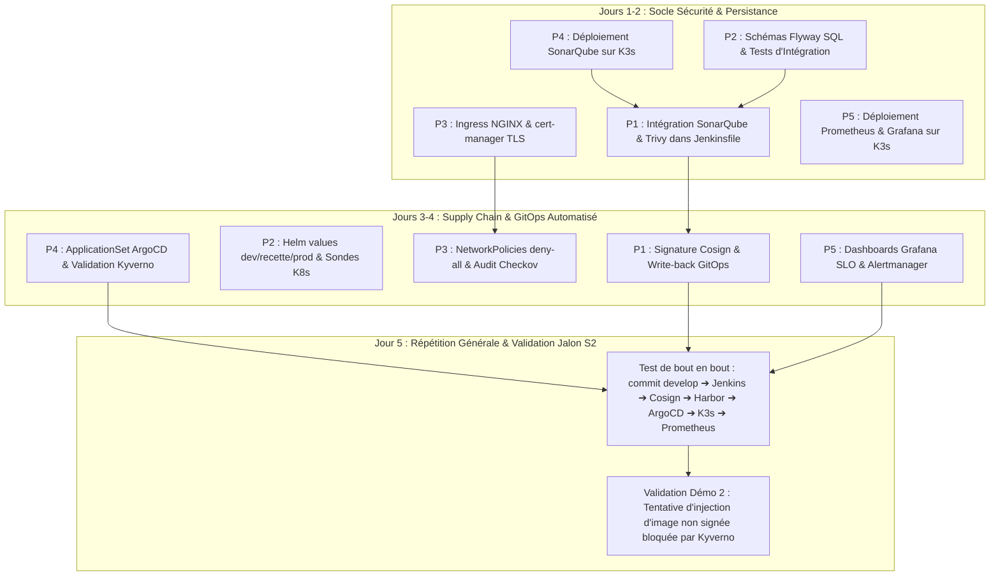

# 🚀 Guide Détaillé & Planning Opérationnel — Semaine 2 (S2)
## Projet : OmniPay Zero-Trust (ESTC)
### Thème S2 : Pipeline Sécurisé DevSecOps, Supply Chain Zero-Trust, GitOps & Observabilité SLO

---

## 🎯 Objectif & Jalon de la Semaine 2

> **Jalon Démontrable S2 (Fin de semaine) :**  
> Un développeur pousse du code dans `develop` (`omnipay-app`).  
> 1. Le pipeline Jenkins s'exécute, applique les scans de sécurité (**Hadolint**, **SonarQube Quality Gate**, **Dependency-Check**, **Trivy**).  
> 2. Une image est construite, un **SBOM (Syft)** est généré, l'image est **signée cryptographiquement avec Cosign**, puis stockée dans **Harbor**.  
> 3. Jenkins met à jour automatiquement le tag d'image dans `omnipay-gitops`.  
> 4. **ArgoCD** synchronise et déploie l'application sur le cluster K3s dans `dev` puis `recette`.  
> 5. **Kyverno** vérifie la signature à l'admission et **bloque toute image non signée**.  
> 6. Les métriques des microservices sont scrapées par **Prometheus** et les **SLO s'affichent en temps réel sur Grafana**.

---

## 👥 Matrice de Répartition des Tâches (P1 à P5)

| Rôle | Membre | Dépôt | Tâches Majeures S2 | Dépendances & Livrables |
|:---:|:---|:---:|:---|:---|
| **P1** | **Ayoub Achmaoui** | `omnipay-app` | Pipeline Jenkinsfile DevSecOps complet, SonarQube Quality Gate, Trivy, Write-Back GitOps | `ci/Jenkinsfile`, scripts d'automatisation |
| **P2** | **Amira Dolf** | `omnipay-app` | Migrations Flyway SQL, tests d'intégration (couverture >80%), sondes K8s, values Helm dev/recette/prod | `services/*/db/migration/`, `helm/values-*.yaml` |
| **P3** | **El Mahdaoui** | `omnipay-app` & `omnipay-gitops` | Modules Terraform réutilisables, Ingress NGINX, cert-manager TLS, NetworkPolicies deny-all, Checkov IaC | `infra/terraform/modules/`, NetworkPolicies |
| **P4** | **Widad El Gharzaz** | `omnipay-gitops` | SonarQube sur K3s, ApplicationSet ArgoCD multi-env, Kyverno signature gate, intégration Cosign/Harbor | `platform/sonarqube/`, ApplicationSet, Kyverno |
| **P5** | **MoadH Elkamel** | `omnipay-gitops` | Déploiement kube-prometheus-stack, Dashboards Grafana as Code, PrometheusRule alertes SLO, Loki logs | `platform/monitoring/dashboards/`, `rules/` |

---

## 📋 Fiches Détaillées par Membre

---

### 🛡️ P1 — Ayoub Achmaoui (Chef Technique, Planning & Pipeline CI/CD DevSecOps)

#### Contexte & Enjeux
En Semaine 1, P1 a posé le socle de base (Jenkins JCasC, Gitleaks, checkout et build Maven). En Semaine 2, P1 doit transformer ce pipeline simple en un **véritable pipeline DevSecOps de niveau bancaire**, intégrant toutes les portes de qualité (Quality Gates) bloquantes.

#### Tâches Détaillées S2
1. **TSK-P1-08 : Intégration des Scans de Sécurité dans le Jenkinsfile**
   - **Hadolint (Lint Dockerfile)** : Vérifier la conformité des Dockerfiles de P2 (pas de root, versions figées, pas de `apt-get` sans clean).
   - **SonarQube Quality Gate** : Déclencher l'analyse statique du code Java et bloquer le build si la porte de qualité échoue (`waitForQualityGate()`). Seuil : 0 vulnérabilité critique, couverture de tests > 80%.
   - **OWASP Dependency-Check** : Scanner les dépendances Maven (`pom.xml`) et identifier les CVEs tierces.
   - **Trivy Container Scan** : Scanner l'image Docker construite avant tout push, avec échec si sévérité `CRITICAL` ou `HIGH`.

2. **TSK-P1-09 : Intégration de la Chaîne Supply Chain Sécurisée (avec P4)**
   - Étape **Syft** : Générer le SBOM (Software Bill of Materials) au format SPDX / CycloneDX JSON pour chaque microservice.
   - Étape **Cosign** : Signer cryptographiquement l'image avec la clé privée de signature injectée dans Jenkins.
   - Pousser l'image, le SBOM et la signature `.sig` dans le registre Harbor (`harbor.omnipay.local:30002`).

3. **TSK-P1-10 : Automatisation du Déploiement GitOps (Write-Back)**
   - En fin de pipeline réussi sur `develop` :
     - Cloner ou mettre à jour le dépôt `omnipay-gitops`.
     - Modifier la référence de version dans `envs/dev/kustomization.yaml` avec le nouveau SHA ou build number (ex: `kustomize edit set image ...:build-${BUILD_NUMBER}`).
     - Commiter et pousser automatiquement vers `omnipay-gitops` (`feat(gitops): deploy build-${BUILD_NUMBER}`).

4. **TSK-P1-11 : Notifications & Gouvernance**
   - Rédiger **ADR-006** (Gestion des secrets de pipeline et identités machines).
   - Configurer les alertes webhook (Discord/Slack/Telegram) en bloc `post` du pipeline.

---

### ☕ P2 — Amir Adolf (Développeur Backend, Persistance & Packaging)

#### Contexte & Enjeux
En Semaine 1, P2 a créé le squelette des microservices et exposé Actuator. En Semaine 2, l'application doit intégrer la persistance PostgreSQL avec gestion des schémas as code (Flyway), des sondes de disponibilité pour Kubernetes, et des configurations Helm adaptées à chaque environnement.

#### Tâches Détaillées S2
1. **TSK-P2-06 : Intégration de Flyway & Schémas Relationnels**
   - Ajouter `flyway-core` et `flyway-database-postgresql` aux dépendances Maven.
   - Écrire les scripts SQL versionnés dans `resources/db/migration/` :
     - `auth-service` : `V1__create_users_table.sql` (id, username, password_hash, role, created_at).
     - `transaction-service` : `V1__create_transactions_table.sql` (id, source_account, target_account, amount, currency, status, timestamp).
   - Valider que Spring Boot exécute automatiquement les migrations au démarrage.

2. **TSK-P2-07 : Tests d'Intégration & Couverture SonarQube**
   - Développer des tests d'intégration avec `MockMvc` et base embarquée/Testcontainers testant :
     - Le flux nominal de virement bancaire.
     - Le rejet en cas de solde insuffisant ou compte invalide.
     - L'idempotence des transactions.
   - Assurer un taux de couverture de code supérieur à 80% pour passer la Quality Gate de P1.

3. **TSK-P2-08 : Découpage Helm Multi-Environnements**
   - Dans `helm/omnipay/`, structurer les valeurs par cible :
     - `values-dev.yaml` : 1 réplica par service, log level `DEBUG`, ressources minimales (`requests: 128Mi`).
     - `values-recette.yaml` : 2 réplicas, log level `INFO`, tolérance aux pannes.
     - `values-prod.yaml` : 3 réplicas avec PodDisruptionBudget, anti-affinité de pod, ressources garanties (`limits: 512Mi`).

4. **TSK-P2-09 : Sondes de Disponibilité & Arrêt Gracieux**
   - Configurer dans `application.yml` :
     ```yaml
     management:
       endpoint:
         health:
           probes:
             enabled: true
     server:
       shutdown: graceful
     ```
   - Renseigner `readinessProbe` et `livenessProbe` sur `/actuator/health/readiness` et `/actuator/health/liveness` dans les templates Helm de déploiement.

---

### 🏗️ P3 — El Mahdaoui (Infrastructure K3s, Réseau & Sécurité Plateforme)

#### Contexte & Enjeux
En Semaine 1, P3 a configuré les bases de K3s et Terraform. En Semaine 2, P3 doit sécuriser le réseau du cluster, exposer les applications via un Ingress controller avec TLS, et mettre en place la micro-segmentation réseau Zero-Trust.

#### Tâches Détaillées S2
1. **TSK-P3-04 : Modularisation Terraform & État Distant**
   - Restructurer `infra/terraform/` en modules distincts :
     - `modules/k3s-nodes/` : Provisionnement machine.
     - `modules/network/` : Configuration sous-réseau et pare-feu.
     - `modules/security/` : Namespaces et labels PSS.
   - Configurer un remote backend avec locking pour éviter les conflits d'état IaC.

2. **TSK-P3-05 : Ingress Controller NGINX & cert-manager TLS**
   - Déployer Ingress NGINX sur le cluster K3s pour acheminer le trafic HTTP/HTTPS entrant sans recourir aux NodePorts directs.
   - Déployer **cert-manager** avec un `ClusterIssuer` auto-signé ou Let's Encrypt (staging) pour chiffrer l'ensemble des communications réseau en HTTPS.

3. **TSK-P3-06 : Micro-segmentation Réseau Zero-Trust (NetworkPolicies)**
   - Définir dans chaque namespace (`omnipay-dev`, `omnipay-recette`, `omnipay-prod`) une règle `default-deny-all` :
     - Bloquer tout trafic Ingress et Egress non explicitement autorisé.
   - Créer les autorisations granulaires minimales :
     - Ingress Controller -> `auth-service` (port 8081).
     - Ingress Controller -> `transaction-service` (port 8082).
     - `transaction-service` -> `postgresql` (port 5432).
     - `transaction-service` -> `notification-service` (port 8083).
     - Prometheus -> microservices (port 8081, 8082, 8083 sur `/actuator/prometheus`).

4. **TSK-P3-07 : Audit IaC Statique (Checkov / Conftest)**
   - Écrire un script `infra/scripts/audit-iac.sh` validant la conformité des fichiers Terraform et manifestes Kubernetes via Checkov.
   - Éliminer tout avertissement lié à des permissions de conteneurs trop permissives.

---

### 📦 P4 — Widad El Gharzaz (Packaging, Registre Sécurisé & Chaîne GitOps)

#### Contexte & Enjeux
En Semaine 1, Widad a intégré la structure GitOps, Harbor, Kyverno et Argo Rollouts. En Semaine 2, elle doit finaliser le serveur SonarQube sur K3s, activer l'automatisation ArgoCD via ApplicationSets, et prouver le rejet automatique d'images non signées par Kyverno.

#### Tâches Détaillées S2
1. **TSK-P4-04 : Déploiement de SonarQube sur K3s**
   - Créer `platform/sonarqube/values-sonarqube.yaml` (édition Community, persistance PostgreSQL, port d'écoute NodePort 30003 ou Ingress `sonarqube.omnipay.local`).
   - Fournir à P1 l'URL et le token d'authentification pour brancher le stage `SonarQube` du Jenkinsfile.

2. **TSK-P4-05 : Déploiement Automatisé ArgoCD avec ApplicationSet**
   - Valider `platform/argocd/applicationsets/applicationset-omnipay.yaml` pour générer automatiquement 3 applications ArgoCD :
     - `omnipay-dev` (surveille `envs/dev/`, auto-sync activé avec auto-prune et self-heal).
     - `omnipay-recette` (surveille `envs/recette/`, auto-sync activé).
     - `omnipay-prod` (surveille `envs/prod/`, sync manuel avec validation humaine).

3. **TSK-P4-06 : Vérification de Signature Kyverno (Préparation Démo 2)**
   - Vérifier la ClusterPolicy `platform/kyverno/policies/disallow-unsigned-images.yaml`.
   - Rédiger et exécuter le scénario de test de la porte d'admission :
     - *Cas nominal :* L'image signée par Jenkins avec la clé `cosign` est admise et déployée sans erreur.
     - *Cas d'attaque :* Une image tierce ou modifiée (non signée) est soumise au cluster -> Kyverno intercepte la requête d'admission et renvoie une erreur `403 Forbidden: Image signature verification failed`.

4. **TSK-P4-07 : Gestion de Cycle de Vie Harbor**
   - Configurer dans Harbor un scan automatique Trivy à chaque push d'image (`scanOnPush: true`).
   - Mettre en place une politique d'immuabilité des tags (interdire l'écrasement d'un tag de version existant).

---

### 📊 P5 — Moad Helkamel (Observabilité, Métriques, SLI/SLO & Alerting)

#### Contexte & Enjeux
En Semaine 1, Moad a rédigé le framework SLI/SLO et préparé les manifestes Helm de monitoring. En Semaine 2, la stack doit être déployée sur le cluster, scraper les microservices réels, afficher les dashboards de SLO sur Grafana, et déclencher des alertes automatiques vers les canaux de communication de l'équipe.

#### Tâches Détaillées S2
1. **TSK-P5-03 : Déploiement de kube-prometheus-stack & Provisioning Grafana as Code**
   - Appliquer `platform/monitoring/values-prometheus.yaml` sur K3s dans le namespace `monitoring`.
   - Créer les ConfigMaps Grafana dans `platform/monitoring/dashboards/` pour auto-importer les dashboards au démarrage :
     - **Dashboard 1 : Golden Signals & SLOs** (Latence p95/p99, Erreurs 5xx %, Débit req/s, Consommation CPU/RAM).
     - **Dashboard 2 : Métriques JVM / Spring Boot** (Heap memory, Garbage Collection pauses, threads actifs).
     - **Dashboard 3 : Infrastructure K3s & Nœuds**.

2. **TSK-P5-04 : Configuration des Règles d'Alerte SLO (PrometheusRule)**
   - Déployer `platform/monitoring/rules/slo-alerts.yaml` contenant les alertes basées sur le budget d'erreur :
     - `OmniPayHighErrorRateBurnRate` : Déclenchée si le taux de consommation du budget d'erreur dépasse le seuil critique sur une fenêtre glissante d'1 heure.
     - `OmniPaySlowResponsesP95` : Déclenchée si la latence p95 dépasse 200 ms pendant plus de 5 minutes consécutives.

3. **TSK-P5-05 : Routage des Alertes vers Discord / Telegram / Slack**
   - Configurer `alertmanager` dans `values-prometheus.yaml` pour relier le récepteur `default-receiver` à un webhook d'équipe.
   - Tester l'envoi d'une alerte synthétique avec `amtool` ou en provoquant une indisponibilité temporaire sur un pod.

4. **TSK-P5-06 : Centralisation des Logs Applicatifs avec Loki & Promtail**
   - Déployer Grafana Loki et l'agent Promtail dans `platform/monitoring/loki/`.
   - Configurer la datasource Loki dans Grafana pour permettre la corrélation instantanée entre une alerte de métrique (Prometheus) et les logs d'erreurs applicatifs (Loki).

---

## 📅 Planning Chronologique de la Semaine 2



---

## ✅ Checklist d'Acceptation du Jalon Semaine 2

- [ ] **Porte de qualité SAST active :** Tout commit cassant les règles SonarQube bloque le build Jenkins.
- [ ] **Scan de conteneurs actif :** Toute CVE critique détectée par Trivy stoppe le pipeline.
- [ ] **Traçabilité logicielle :** Chaque image poussée dans Harbor dispose d'un SBOM Syft et d'une signature Cosign.
- [ ] **Déploiement GitOps sans contact :** Jenkins met à jour `omnipay-gitops`, et ArgoCD déploie automatiquement sur K3s sans intervention manuelle.
- [ ] **Admission Control Zero-Trust :** Kyverno rejette immédiatement tout déploiement dont l'image n'est pas signée par la clé du projet.
- [ ] **Observabilité en temps réel :** Le tableau de bord Grafana affiche les 4 Golden Signals et les SLO des 3 microservices.
