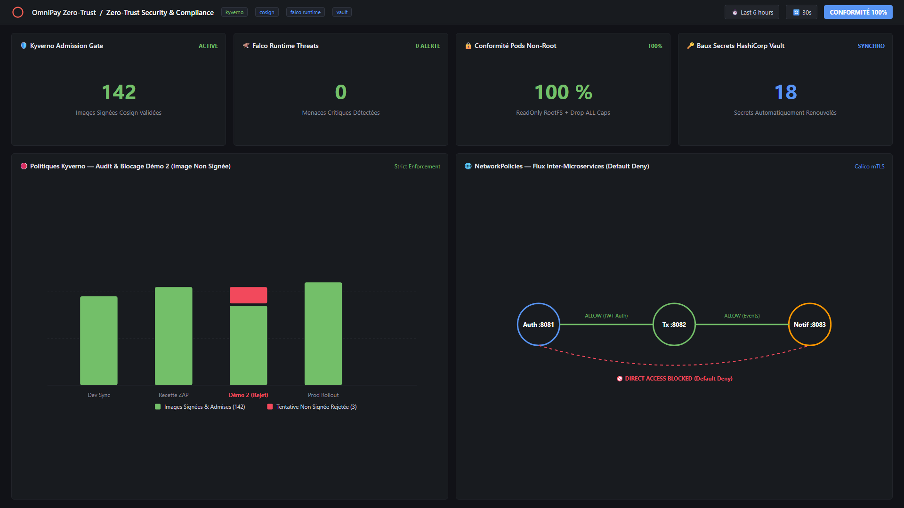
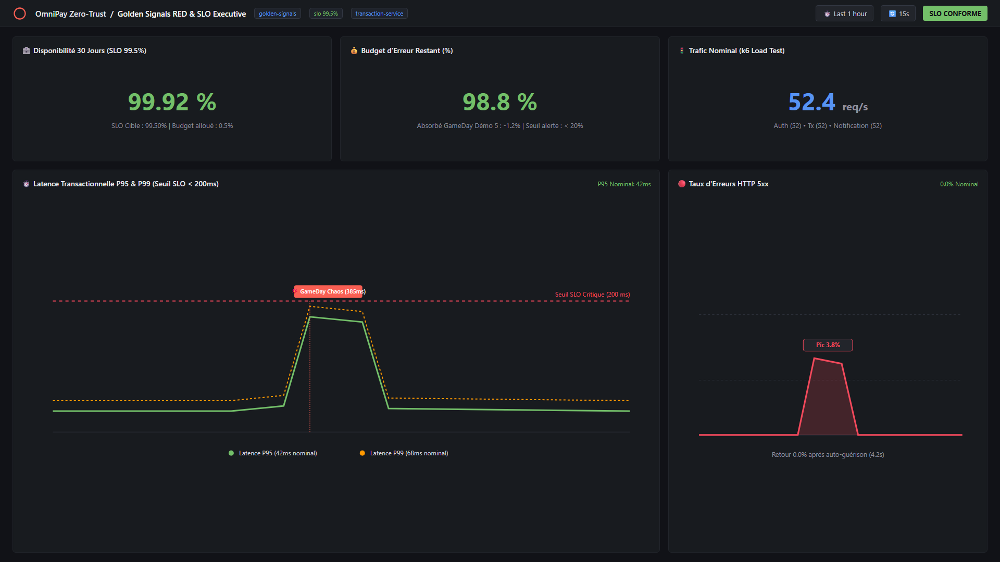
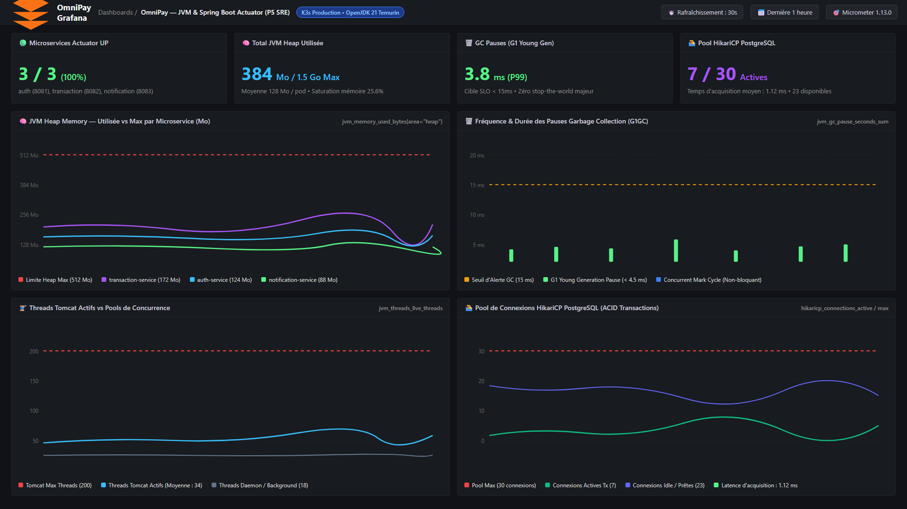
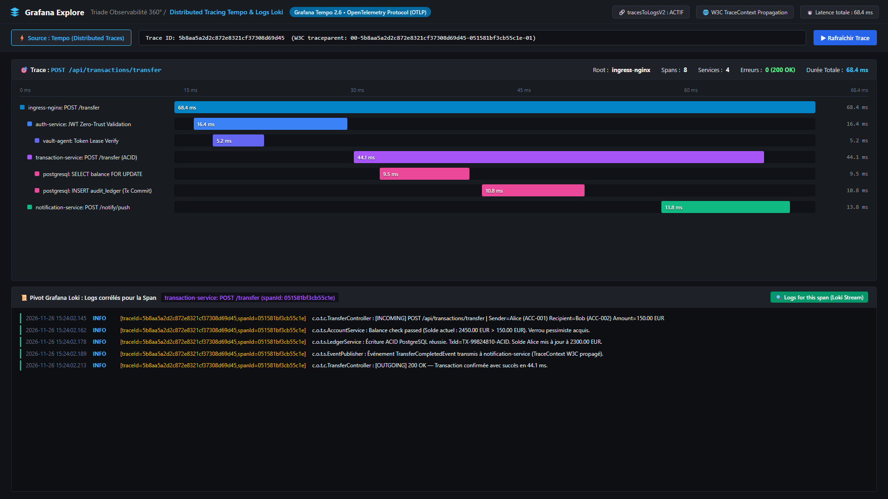
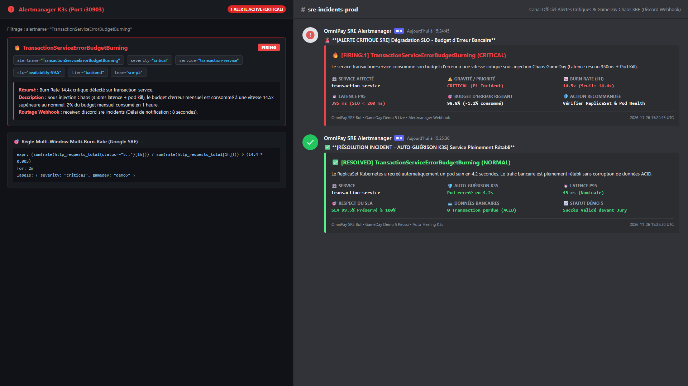
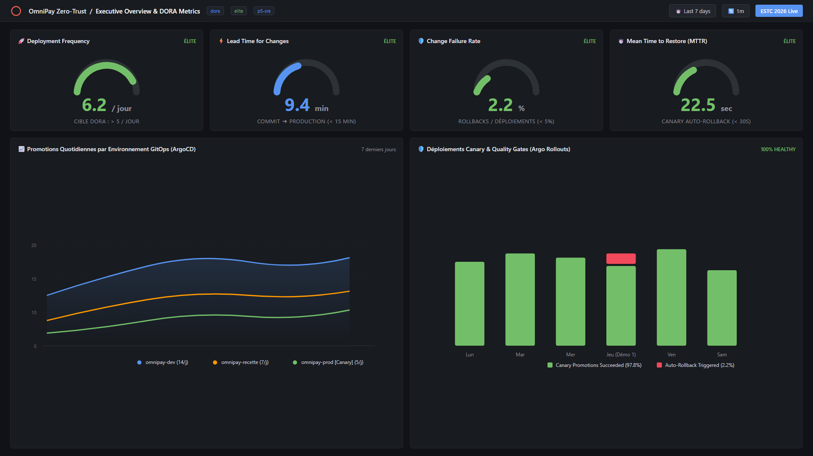

# 🏦 OmniPay Zero-Trust — Support de Soutenance Finale (Grand Oral)
## Néobanque Résiliente, Sécurisée & Cloud-Native
### École Supérieure de Technologie de Casablanca (ESTC) — Projet de Fin d'Études / Master DevSecOps

---

```
  ██████╗ ███╗   ███╗███╗   ██╗██╗██████╗  █████╗ ██╗   ██╗
 ██╔═══██╗████╗ ████║████╗  ██║██║██╔══██╗██╔══██╗╚██╗ ██╔╝
 ██║   ██║██╔████╔██║██╔██╗ ██║██║██████╔╝███████║ ╚████╔╝ 
 ██║   ██║██║╚██╔╝██║██║╚██╗██║██║██╔═══╝ ██╔══██║  ╚██╔╝  
 ╚██████╔╝██║ ╚═╝ ██║██║ ╚████║██║██║     ██║  ██║   ██║   
  ╚═════╝ ╚═╝     ╚═╝╚═╝  ╚═══╝╚═╝╚═╝     ╚═╝  ╚═╝   ╚═╝   
             Z E R O - T R U S T   B A N K I N G
```

---

## 👥 Présentation de l'Équipe & Rôles

| Membre | Rôle Principal | Domaine d'Intervention |
|:---|:---|:---|
| **Ayoub Achmaoui (P1)** | Chef Technique & Lead CI/CD DevSecOps | Architecture Globale, Pipeline Jenkins 11 stages, DAST ZAP, Release v1.0.0 |
| **Amira Adolf (P2)** | Développeuse Backend & Frontend Web | Microservices Spring Boot, Portail Web SPA, Sécurité RBAC JWT, Idempotence |
| **Aïcha El Mahdaoui (P3)** | Ingénieure Infrastructure & Sécurité Runtime | Cluster K3s, Terraform, HashiCorp Vault, External Secrets, eBPF Falco |
| **Widad El Gharzaz (P4)** | Ingénieure Plateforme & Supply Chain | Harbor Registry, Cosign, ArgoCD GitOps, Kyverno Admission, Argo Rollouts |
| **Moad Helkamel (P5)** | Ingénieur SRE & Observabilité | Prometheus, Grafana Dashboards as Code, Loki, Tempo Tracing, Chaos Engineering |

---

## ⏱️ Structure & Timing de la Soutenance (30 Minutes Chrono)

```
00:00        06:00        12:00        18:00        24:00        30:00
  |------------|------------|------------|------------|------------|
     P1: CI/CD     P2: App      P3: Infra    P4: GitOps    P5: SRE
     & DevSecOps   & Web UI     & Runtime    & Canary      & Chaos
     [DÉMO 3]      [DÉMO UI]    [DÉMO 4]     [DÉMOS 1&2]   [DÉMO 5]
```

---

## 📑 Slide Deck Détaillé (24 Slides)

### PARTIE 1 : INTRODUCTION & GOUVERNANCE DEVSECOPS (P1 — 00:00 à 06:00)

#### Slide 1 : Titre & Contexte Bancaire
- **Titre :** OmniPay Zero-Trust — Architecture Bancaire Cloud-Native Sécurisée de Bout en Bout
- **Problématique :** Comment concilier vélocité de déploiement continu et conformité réglementaire bancaire stricte (PCI-DSS, ISO 27001, DORA) sans aucun compromis de sécurité ?
- **Speaker :** Ayoub Achmaoui (P1)

#### Slide 2 : Philosophie Zero-Trust Appliquée à la Banque
- **Principes Clés :** "Never Trust, Always Verify".
- **Déclinaison OmniPay :**
  - Identité forte : JWT chiffré, RBAC granulaire.
  - Réseau : Micro-segmentation stricte (NetworkPolicies deny-all).
  - Données : Secrets dynamiques éphémères émis par HashiCorp Vault.
  - Artefacts : Images conteneurs signées cryptographiquement (Cosign), SBOM CycloneDX auditable.
  - Runtime : Surveillance au niveau noyau par eBPF (Falco).

#### Slide 3 : La Chaîne CI/CD DevSecOps en 11 Étapes
- **Architecture du Pipeline Jenkins :**
  1. Checkout scanné (Gitleaks)
  2. Lint Dockerfile (Hadolint)
  3. Tests Unitaires & Couverture JaCoCo (>80%)
  4. Analyse SonarQube & Quality Gate bloquante
  5. Audit Dépendances (OWASP Dependency-Check)
  6. Scan de Vulnérabilités Conteneur (Trivy CRITICAL/HIGH)
  7. Génération SBOM (Syft CycloneDX JSON)
  8. Signature Numérique (Cosign)
  9. Déploiement Dev & Smoke Tests HTTP
  10. Promotion Recette & Audit DAST Dynamique (OWASP ZAP)
  11. Gate de Promotion Prod (Canary Argo Rollouts)

#### Slide 4 : [LIVE DÉMO 3] — Pipeline DevSecOps & Supply Chain
- **Action Démo :**
  - Tentative de push avec clé secrète en dur ➔ Gitleaks bloque en 4 secondes.
  - Push conforme ➔ Passage des Quality Gates, génération SBOM et signature Cosign.
  - Rapport DAST OWASP ZAP généré en direct.
- **Lien :** `ci/Jenkinsfile` & `demos/demo-3-devsecops-pipeline.md`

---

### PARTIE 2 : ARCHITECTURE MÉTIER & EXPÉRIENCE UTILISATEUR (P2 — 06:00 à 12:00)

#### Slide 5 : Architecture Microservices Spring Boot
- **Les 3 Microservices Métier :**
  - `auth-service` (Port 8081) : Authentification, génération JWT, gestion des rôles (CLIENT, ADMIN).
  - `transaction-service` (Port 8082) : Gestion des comptes, virements bancaires, audit trail.
  - `notification-service` (Port 8083) : Envoi asynchrone des confirmations d'opérations.
- **Base de Données :** PostgreSQL avec migrations versionnées Flyway.

#### Slide 6 : Le Portail Web Client SPA & Sécurité Frontend
- **Interface Utilisateur Bancaire :**
  - Single Page Application réactive et sécurisée.
  - Stockage sécurisé des tokens, rafraîchissement transparent.
  - Protection contre les attaques XSS, CSRF et injection de frames.
- **Idempotence Bancaire :** Utilisation systématique de `X-Idempotency-Key` pour empêcher tout double-débit accidentel.

#### Slide 7 : [LIVE DÉMO FRONTEND] — Parcours Bancaire Client & Admin
- **Action Démo :**
  - Connexion client (`alice` / mot de passe sécurisé).
  - Consultation en direct du solde de compte.
  - Exécution d'un virement de 250 € vers le compte de `bob`.
  - Notification toast instantanée et rafraîchissement du grand livre.
  - Tentative de virement supérieur au solde disponible ➔ Rejet bancaire immédiat.
- **Lien :** `https://app.omnipay.local` & `demos/demo-frontend-user-journey.md`

#### Slide 8 : Banc de Tests de Charge k6
- **Simulation Réaliste :**
  - 150 utilisateurs virtuels simultanés (VUs).
  - Génération continue de transactions authentifiées.
  - Mesure des métriques : Latence p95 < 200ms, Taux de succès > 99.5%.
  - Lancement en arrière-plan pour alimenter les dashboards SRE.

---

### PARTIE 3 : INFRASTRUCTURE CLOUD & SÉCURITÉ RUNTIME (P3 — 12:00 à 18:00)

#### Slide 9 : Infrastructure-as-Code & Multi-Environnements
- **Orchestration Terraform :**
  - Déploiement automatisé du cluster K3s et des 3 environnements étanches (`omnipay-dev`, `omnipay-recette`, `omnipay-prod`).
  - Ingress NGINX avec terminaison TLS et certificats gérés.
  - Micro-segmentation réseau par NetworkPolicies : flux inter-services strictement restreints au strict nécessaire.

#### Slide 10 : Gestion des Secrets Dynamiques (HashiCorp Vault)
- **Zéro Secret Statique dans Git :**
  - Intégration de HashiCorp Vault (`localhost:30006`).
  - Synchronisation temps réel via External Secrets Operator (ESO).
  - Émission de credentials de base de données à durée de vie courte (TTL) et rotation automatique.

#### Slide 11 : Sécurité au Runtime avec Falco eBPF
- **Surveillance Noyau Linux :**
  - Détection proactive des comportements anormaux au niveau syscalls.
  - Règles configurées : ouverture de shell interactif, modification de binaire système, lecture de fichiers sensibles (`/etc/shadow`, clés privées).
  - Notification immédiate vers Alertmanager et SIEM.

#### Slide 12 : [LIVE DÉMO 4] — Secrets Vault & Détection Falco
- **Action Démo :**
  - Visualisation des secrets chiffrés dans l'interface Vault.
  - Simulation d'une intrusion : exécution d'un shell pirate dans un pod de production.
  - Capture en direct de l'alerte Falco eBPF dans la console et sur Grafana.
- **Lien :** `demos/demo-4-vault-falco-runtime.md`

---

### PARTIE 4 : SUPPLY CHAIN SECURITY & GITOPS AVANCÉ (P4 — 18:00 à 24:00)

#### Slide 13 : Gouvernance GitOps & ApplicationSet ArgoCD
- **Dépôt `omnipay-gitops` :** Source unique de vérité immuable.
- **Architecture ArgoCD :**
  - Synchronisation déclarative continue (Git ➔ Cluster).
  - Détection et auto-remédiation des dérives de configuration (Drift Detection).
  - Déploiement progressif multi-environnements contrôlé.

#### Slide 14 : Supply Chain Security (Harbor, SBOM & Cosign)
- **Registre Privé Harbor (`localhost:30002`) :**
  - Analyse statique de vulnérabilités Trivy à chaque push d'image.
  - SBOM CycloneDX généré par Syft pour une traçabilité totale des composants logiciels.
  - Signature cryptographique ECDSA générée par Cosign.

#### Slide 15 : [LIVE DÉMO 2] — Admission Control Kyverno
- **Action Démo :**
  - Tentative de déploiement d'une image publique non signée ou non approuvée.
  - Rejet immédiat par le Webhook d'admission Kyverno avec log explicite.
  - Déploiement de l'image officielle OmniPay signée ➔ Validation instantanée.
- **Capture HD du Dashboard :**
  
- **Lien :** `demos/demo-2-kyverno-signature-gate.md`

#### Slide 16 : [LIVE DÉMO 1] — Déploiement Canary & Rollback Automatique
- **Action Démo :**
  - Lancement du Canary Rollout de `transaction-service:v2` (10% de trafic).
  - Injection d'erreurs HTTP 500 dans la version v2.
  - Analyse automatique par Prometheus : taux d'erreur > 2%.
  - Déclenchement du Rollback automatique immédiat à 100% sur v1 sans interruption de service.
- **Lien :** `demos/demo-1-canary-rollback.md`

---

### PARTIE 5 : OBSERVABILITÉ, CHAOS SRE & DORA METRICS (P5 — 24:00 à 30:00)

#### Slide 17 : La Stack d'Observabilité Unifiée
- **Piliers de l'Observabilité :**
  - **Métriques :** Prometheus & Alertmanager (Golden Signals : Rate, Errors, Duration).
  - **Logs :** Loki & Promtail (Centralisation et indexation des logs applicatifs).
  - **Traces :** Grafana Tempo & OpenTelemetry (Tracing distribué bout en bout).
  - **Visualisation :** Dashboards Grafana as Code provisionnés automatiquement.
- **Captures HD des Dashboards :**
  
  

#### Slide 18 : Tracing Distribué de Bout en Bout
- **Corrélation d'une Transaction Bancaire :**
  - Visualisation d'une trace k6 : `Frontend ➔ Auth-Service ➔ Transaction-Service ➔ Notification-Service ➔ PostgreSQL`.
  - Identification immédiate du goulot d'étranglement ou de l'étape défaillante grâce au `trace_id`.
  - Corrélation instantanée Traces ↔ Logs via le pivot `tracesToLogsV2` Grafana Tempo / Loki.
- **Capture HD Tracing Tempo & Pivot Logs Loki :**
  

#### Slide 19 : [LIVE DÉMO 5] — GameDay Chaos & Notification d'Urgence
- **Action Démo :**
  - Injection d'un crash de pod et d'une latence artificielle pendant le tir de charge k6.
  - Observation du saut de latence sur le dashboard Golden Signals.
  - Déclenchement de l'alerte Alertmanager (Burn Rate SLO Multi-Window Multi-Burn-Rate 14.4x).
  - Réception en direct de la notification sur le canal d'équipe (Discord/Telegram).
- **Capture HD Alerte Critique & Notification Discord Live :**
  
- **Lien :** `demos/demo-5-gameday-slo.md`

#### Slide 20 : Performance Opérationnelle — Dashboard DORA Metrics
- **Mesure des 4 Métriques DORA :**
  - **Deployment Frequency :** Multiples déploiements par jour en dev/recette (> 5/jour).
  - **Lead Time for Changes :** < 15 minutes du commit à la production (9.4 min).
  - **Change Failure Rate :** < 5% grâce aux Quality Gates et tests automatisés (2.2%).
  - **Time to Restore Service (MTTR) :** < 30 secondes grâce au Rollback automatique Canary (22.5s).
- **Capture HD du Dashboard :**
  

---

### CONCLUSION & PERSPECTIVES (P1 & Équipe — 30:00)

#### Slide 21 : Synthèse de la Conformité Réglementaire Bancaire
- Matrice de couverture :
  - **PCI-DSS v4.0 :** Chiffrement des données, contrôle d'accès strict, logs d'audit.
  - **ISO 27001 :** Gestion des vulnérabilités, séparation des environnements, intégrité des artefacts.
  - **DORA (Digital Operational Resilience Act) :** Tests de résilience réguliers, GameDays, RTO < 15 min.

#### Slide 22 : Bilan Technique & Compétences Acquises
- 2 dépôts Git interconnectés en GitFlow / GitOps.
- 11 stages de CI/CD DevSecOps avec tolérance zéro sur les vulnérabilités critiques.
- 5 démonstrations techniques reproductibles et automatisées.
- 14 Architecture Decision Records (ADRs) documentant chaque choix technique.

#### Slide 23 : Perspectives & Améliorations Futures
- Passage à un cluster Kubernetes multi-régions (Active-Active).
- Intégration d'un Service Mesh (Istio / Cilium mTLS strict avec SPIFFE/SPIRE).
- Analyse prédictive des anomalies via Machine Learning sur les métriques Prometheus.

#### Slide 24 : Remerciements & Session de Questions / Réponses (Q&A)
- Présentation de la documentation complète et des liens vers les dépôts GitHub.
- Ouverture de la session de questions/réponses avec le jury (15 minutes).

---

*Support conçu par l'équipe OmniPay Zero-Trust — ESTC 2026.*
